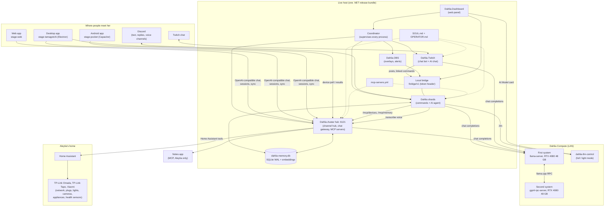
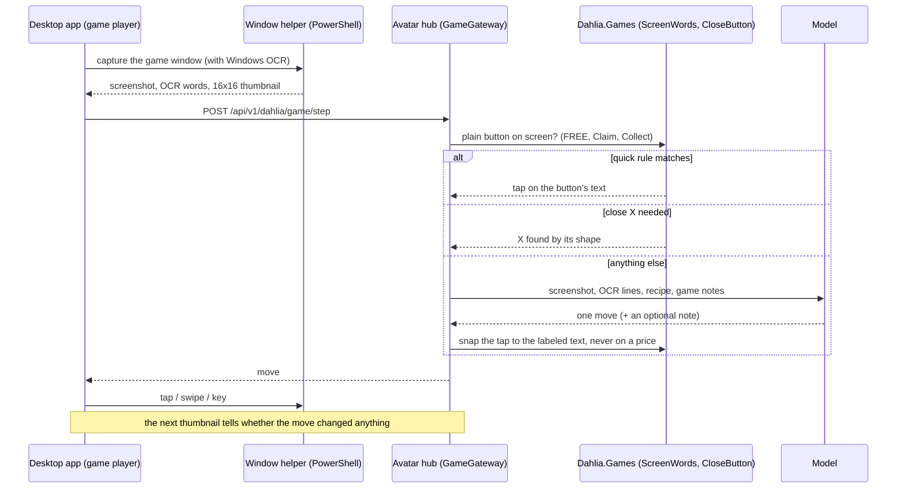
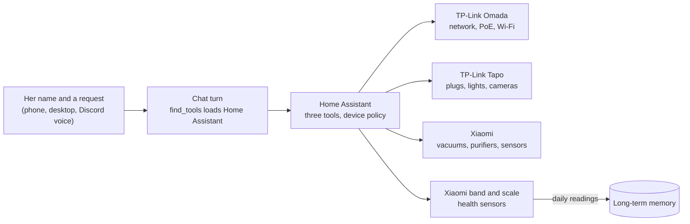
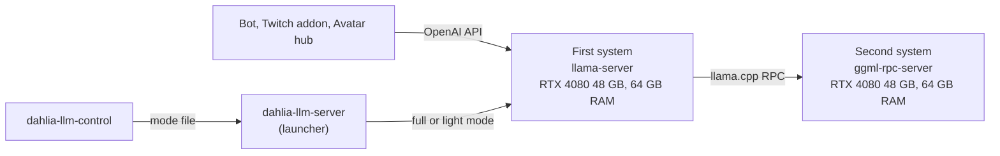
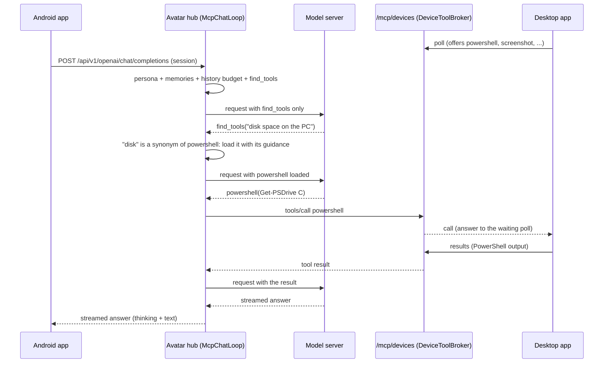

# Research & Architecture: AleytiaFairlight/Dahlia AI Assistant and All Around Companion

> **Draft.** A snapshot of the codebase on 2026-11-10. Versions, models and numbers change often; check the
> repository before relying on them.

A technical dissection of [`AleytiaFairlight/Dahlia`](https://github.com/AleytiaFairlight/Dahlia), a Discord bot,
Twitch bot, streaming dashboard and AI companion in one C# / .NET 9 codebase, with web, desktop and Android apps.

- **Repository**: [AleytiaFairlight/Dahlia](https://github.com/AleytiaFairlight/Dahlia) (private)
- **Apps repository**: [AleytiaFairlight/Dahlia-avatar](https://github.com/AleytiaFairlight/Dahlia-avatar), branch `dahlia` (public)
- **Snapshot**: `main` at `d137a26f5`
- **Component versions**: Dahlia `3.9.1`, DahliaTwitch `2.23.0.4`, Dahlia Avatar `0.5`, Dashboard `1.3.0`, DahliaGames, DahliaSocial and DahliaYouTube `0.1`
- **App version**: `0.12.2-beta.6`
- **Model**: Dahlia's own, trained on DeepSeek V3's weights for her criteria and feature set, split between two systems
  (see [Dahlia Compute](#12-dahlia-compute-her-own-model-on-two-systems))

---

## Executive Summary

Most AI companion projects start from the avatar: a VRM model, a voice pipeline and an LLM loop behind them.
Dahlia started from the other end: a Discord bot with hundreds of commands, a Twitch bot, a streaming dashboard and an
AI agent, and only then an avatar. The avatar apps are a thin, locked-down client of a server that already knows her
users, her commands and her memory.

The result is one persona that lives in five places (Discord, Twitch, the apps, Aleytia's PC and home), with
one model, one memory and one tool system behind all of them:

1. **One persona everywhere.** `SOUL.md` and `OPERATOR.md` open every system prompt, on Discord, on Twitch and in
   the apps. The apps send no character text of their own; the hub writes the persona into each request
   (`Gateway/DahliaPersona.cs`).
2. **Server-side brain.** The apps have no provider choice, accounts or cloud of their own. They talk to an
   OpenAI-compatible endpoint on the Dahlia Avatar hub (`src/Dahlia.Avatar`), which also runs the tools, the memory
   and the persona.
3. **Tools on demand.** Every tool (the bot's own, MCP servers', the PC's, the phone's, Twitch's) sits behind one
   `find_tools` call. A plain answer reads a short prompt; a tool's description costs tokens only once the model
   looked for it (`McpToolLoadout`, since 2026-11-02).
4. **Shared long-term memory.** The bot and the hub share one SQLite memory (`data/dahlia-memory.db`, WAL mode)
   with MiniLM embeddings, deduplication by meaning and a fixed prompt budget.
5. **The PC as a body.** The desktop app lends its tools (PowerShell, screenshots, taps, SSH, a network scan, game
   control) to Dahlia on every other device, through a polling broker on the hub. She plays a mobile game on the
   PC from its screen text and learns it by watching Aleytia play.
6. **Voice as identity.** The apps sign in with a key plus a voice check: a speaker embedding against an enrolled
   voice print and a spoken challenge, which opens a six-hour session.
7. **A home run by voice.** Through Home Assistant she controls Aleytia's TP-Link Omada network, TP-Link Tapo
   plugs, lights and cameras, and Xiaomi appliances and sensors, from a spoken request on any device. Xiaomi
   wearables and scales feed a health record that she keeps in her memory and reads back as trends.
8. **Her own model, across two systems.** Instead of DeepSeek V3 as published, Dahlia runs a model trained on its
   weights for her own criteria and feature set. It runs on llama.cpp, split over the LAN between two systems with an
   RTX 4080 48 GB each (RPC backend), and the server is always online. A "light mode" frees the second system for
   streaming.
9. **Self-deploying releases.** CI builds one bundle for the whole server. The live host pulls it every hour, checks
   that the bot comes up, and rolls back when it doesn't.

---

## System Architecture

The live host runs one release bundle. CI builds it on every passing `main` push, and the host pulls and installs it
itself (see [Delivery](#delivery-ci-bundles-autodeploy-and-app-releases)).

---

## Components at a Glance

| Component | Project | What it does |
| --- | --- | --- |
| Dahlia | `src/DahliaBot`, `avatar/` (Home Assistant module) | Moderation, permissions, custom expressions, music, games, gambling, XP, searches, feeds, stream notifications and the AI agent: about 540 commands in 11 modules. Home and health: voice control of TP-Link Omada, TP-Link Tapo and Xiaomi devices through Home Assistant, and health tracking from Xiaomi wearables and scales. |
| Coordinator | `src/DahliaBot.Coordinator` | Starts and supervises the shards and the Twitch, OBS and Avatar processes. |
| DahliaTwitch | `src/Dahlia.Twitch`, `src/Dahlia.OBS` | Twitch chat bot, channel points, polls, bets, economy, alerts and OBS overlays. |
| DahliaYouTube | `src/Dahlia.YouTube` | Live stream detection, Connect YouTube, live chat commands and moderation. |
| DahliaSocial | `src/Dahlia.Social` | Facebook, Instagram, TikTok, X and Threads connections. |
| DahliaGames | `src/Dahlia.Games` | HoYoLAB automation, game data and build checks, a Genshin planner, and screen reading for game play. |
| Dashboard | `src/Dahlia.Dashboard` | The web panel and the Streaming Dashboard. |
| Dahlia Avatar | `src/Dahlia.Avatar`, `avatar/` | The hub server and the web, desktop and Android apps. |
| Dahlia Compute | `deploy/compute/` | The model server and the helper installer. |

---

## Subsystem Deep Dive

### 1. Process Model: Coordinator and Local Bridge

`src/DahliaBot.Coordinator` starts and supervises every process: the bot shards, the Twitch addon, the OBS bridge and
the Avatar hub. It relays each child's log lines at the child's own level, so warnings keep their severity in the
journal, and restarts them gracefully.

Two rules keep a failing addon from taking Discord down:

- Only the first start of an addon waits a round. An addon that keeps crashing doesn't hold up the shards
  (Dahlia.Twitch once did on an empty config, and Discord stayed offline).
- The hub is optional. Starting it never counts as a coordinator action, it keeps running through shard restarts
  so the apps stay connected, and its restarts back off from 10 seconds to 10 minutes after quick exits.

Each shard hosts a **local HTTP bridge** (`Services/LocalBridge/LocalBridgeService.cs`, `/bridge/v1`, one port per
shard, a token header on every request). The Twitch addon, the OBS bridge and the Dashboard call it for guild
metadata, stream music, Discord posts and linked commands and roles. A request for a Twitch channel's linked Discord
server goes to each shard in turn until the one that has it answers `Handled`.

---

### 2. The Discord AI Agent

`src/DahliaBot/Modules/Utility/AiAgent` is the agent: the model reads a message, calls bot commands and read-only data
tools as the user, and replies. Its tools are adapter methods marked `[AiTool]` (`Adapters/*.AiAdapter.cs`), with
`run_command` and `run_command_chain` for ordinary bot commands, and permission attributes (`AiRequiresPerm`,
`AiOwnerOnly`, `AiSafeMutation`) so the agent can do only what the user could do with the same commands.

Around that core sit the MCP hub, memory, voice chat, a music adapter, a turn log, the model-server switch and three
output guards.

#### When she answers

- A mention, a reply to her, `.agent`, or her name. Her name at the start ("Dahlia, who made you?", "hi Dahlia") or
  end (", Dahlia") always counts. Other mentions of the name count only when a small classification head on the
  command-search embeddings sees a command request.
- Within the follow-up window (120 seconds by default) after she answered someone, that person needs no name.
- An alias, a scheduled command or a command the agent itself ran never starts the agent; a voice-chat transcript
  does.

#### Prompt layout

`Prompts/SystemPromptBuilder.cs` orders the prompt for prompt caching:

1. **Static system prompt**: `SOUL.md` (identity), `OPERATOR.md` (operator rules), platform guidance and a fixed
   untrusted-content rule that the operator can't delete by accident. It stays the same for every server, so the
   model server caches it once.
2. **Channel history**: the last messages of the channel (20 by default), with embeds as labeled sections, trimmed to
   the idle window after a restart so old unanswered questions don't come back.
3. **Per-turn context**: server, channel, time, skills and memories, as a separate message after the history.
4. **The request.**

Server administrators add **skills** (`.agentskilladd`, `.agentchannelskilladd`): extra instructions for a server
or one channel. A skill changes style and topics, never permissions.

#### The tool loop

`AiAgentSession` runs up to `MaxToolCalls` steps (10 by default). Every step sends the loaded tools; the first
carries only `find_tools` plus whatever `Preload` picked from the request:

- **Preload**: up to four tools and bot commands that the request names outright ("remind me in 2 hours" brings
  `.remind` with `run_command`), so the model can act in its first step.
- **Companions**: tools that load together. `web_search` brings `send_message`, because in bake-offs models searched,
  wrote "I'll post this in #general" and stopped with nothing loaded that posts. A device's `tap` brings its
  `screenshot`.
- **Synonyms**: "prune messages" finds `delete_message`, "google" finds the web tools.

#### Output guards

Local models misbehave in ways hosted APIs hide. Dahlia guards three of them on the bot and the hub alike:

| Guard | Problem it handles |
| --- | --- |
| `ToolCallMarkup` | Tool calls written as text (DeepSeek-style `<｜tool▁call▁begin｜>` markers in ASCII or full-width bars), or tool results copied into the reply. It parses the calls it can and strips the rest. |
| `RepeatGuard` | The same line, or block of up to three lines, three times in a row. The model server runs with no repetition penalties (DRY and frequency penalties garbled code, dates and IP addresses), so the guard cuts the loop instead. |
| `ActionAnnouncement` and the empty-reply check | A reply that only says it will act ("let me check") gets one nudge to act; an empty reply after a tool result is asked again once. |

#### Turn log

`AiAgentTurnLogService` saves finished turns for review. Approved turns, with corrections replacing the final reply,
export as fine-tuning data in OpenAI's chat format (`{"messages": [...], "tools": [...]}` per line). This is the data
her own model is trained on (see [Dahlia Compute](#12-dahlia-compute-her-own-model-on-two-systems)).

---

### 3. MCP Tool Hub

`Mcp/McpToolHub.cs` is a minimal MCP client over Streamable HTTP (`initialize`, `tools/list`, `tools/call`) that
keeps the server's session id and starts a new one when the server forgets it. Servers are listed in
`data/mcp-servers.yml`, which is read again when it changes:

| Server | What it gives her | Audience |
| --- | --- | --- |
| Notes app (Core) | Notes, checklists and boards | Aleytia only: it acts with Aleytia's key |
| `devices` (the hub's `/mcp/devices`) | Aleytia's PC and phone tools | Apps; Discord for Aleytia |
| `memory` (the hub's `/mcp/memory`) | `remember`, `recall`, `forget` | Apps; Discord for Aleytia |

Each server has a tool prefix (`core_create_note`), an audience for Discord (`owner`, `everyone` or `off`), a
switch for the apps, an optional tool allowlist, and a description that `find_tools` shows the model. Results can
carry images (screenshots) as data URLs for a model that can see them.

`IMcpTools` is shared by the bot and the hub, so both resolve the same tools with the same `McpToolLoadout`.
`find_tools` scores tools by name words, description words and synonyms, keeps those within half of the best score,
and loads at most eight.

---

### 4. Long-Term Memory

`Memory/DahliaMemory.cs` is the memory both processes share:

- **Entries** are short sentences (600 characters at most) with a subject (`owner`, `game:<id>`, `user:<id>`), a kind
  (`fact`, `conversation`, `game`) and a source (`discord`, `app`, a game id, or a conversation key).
- **Embeddings**: each entry carries an all-MiniLM embedding (ONNX, in-process). A new memory at least 0.9 similar
  to an old one of the same kind replaces it, and so does a new summary of the same conversation. Without the model,
  word overlap (0.75) decides.
- **Limits**: 2,000 memories per subject (the oldest go first). The prompt gets about 600 tokens of memories: lasting
  facts first, then what recent conversations were about. She finds older ones with `recall`.
- **Privacy**: on Discord only Aleytia's conversations are remembered. Other people in the apps have their own
  memories without memory tools. A per-person "Use long-term memory" switch, synced from the apps
  (`MemorySwitch`), stops reading, saving and summarizing on every platform without deleting anything.

---

### 5. The Dahlia Avatar Hub (`src/Dahlia.Avatar`)

About 8,400 lines of C#: the server side of the apps.

#### Channel hub

`Hub/ChannelHub.cs` is the apps' channel server: peer authentication, the registry of extension modules, routing of
protocol events, and liveness (a silent peer is unhealthy after one heartbeat TTL and disconnected after two).
`ui:configure` needs an authenticated peer, and a peer that recovers is reported healthy for each of its modules.

#### Chat gateway pipeline

`POST /api/v1/openai/chat/completions` is what the apps see as an OpenAI provider. Each request goes through:

1. **Session check**: the key opens only the voice check. Chats need a session.
2. **Persona** (`DahliaPersona`): `SOUL.md` and `OPERATOR.md` go before the apps' stage instructions (emotions,
   motions).
3. **Memory** (`MemoryPrompt`): the person's memories, unless their switch is off.
4. **History budget** (`ChatHistoryBudget`): the apps send the whole conversation, so the hub drops the oldest turns
   until the request fits the model's real window (read from llama-server's `/props`). It adds a note that points
   her at `recall`. llama.cpp's context shift would do the same blindly, but it is unavailable with an RPC split and
   a quantized KV cache.
5. **Tool loop** (`McpChatLoop`): the hub adds `find_tools` and the tools it found, runs MCP calls itself and asks
   the model again. A call of one of the app's own tools goes back to the app, so the apps need nothing new.
   Thinking and text still stream as they come. The hub also stops text that keeps narrating a screen action
   without calling a tool, so she can't make up what the screen showed.
6. **Output guards**: `RepeatGuard` stops the stream, nudges once, then ends; tool markup is stripped.

Some chat templates drop every system message after the first, so the hub's nudges are user messages that start
with "[Dahlia's server]".

#### Users and the voice check

`Gateway/AvatarUsers.cs` and `Gateway/VoicePrint.cs`:

- Aleytia signs in with the hub token and makes keys for other people in the apps. Tokens and sessions are
  stored as hashes in `data/avatar-users.json` (mode 0600).
- **Enrollment**: the person reads several challenges aloud. A challenge is a sentence plus random digits.
- **Check**: the hub runs a speaker model (3D-Speaker ERes2Net) and a speech model (Moonshine tiny), both through
  sherpa-onnx, about 60 MB in all. The voice must match the voice print, the digits must match exactly (so an old
  recording fails), and most of the sentence's words must be there.
- A passed check opens a **six-hour session** for that device. Every route except the voice check needs one.

#### Chat sync, settings and recipes

Chat sync runs against the hub (`ChatSync.cs`, `data/avatar-chats.db`), with the key's person as the user and the
session as the sign-in, so the same conversation shows on the phone and the PC. Settings (`SettingsSync.cs`) and
recipes (`RecipeSync.cs`) sync the same way.

#### Device tools broker

`Gateway/DeviceTools.cs` lets one device's tools serve Dahlia on every other device:

- The desktop app long-polls `POST /api/v1/dahlia/devices/poll` with the tools it offers and receives calls. It posts
  results to `/api/v1/dahlia/devices/results`.
- The hub serves those tools as an MCP server, `/mcp/devices`, to its own host only. It is listed in
  `mcp-servers.yml` like any other server, so the apps' chat and, for Aleytia, Discord use the same tools.
- Known devices and their tools persist (`data/avatar-devices.json`), so the tools stay listed after a restart. A
  call to a device that is offline says so, and `devices_status` reports what is connected.
- Device results are capped at 16k characters.

The desktop app currently offers 17 tools: `powershell`, `ssh`, `ssh_key`, `ssh_install_key`, `network_scan`,
`screenshot`, `screen_record`, `tap`, `swipe`, `press_key`, and the game tools `game_find`, `game_launch`,
`game_play`, `game_status`, `game_stop`, `game_watch`, `game_watch_stop`. The app offers them from its main window
only, and the PC can ask for a confirmation before a tool acts. The phone offers a notification.

#### Release mirror and speech endpoint

- **Release mirror** (`ReleaseMirror.cs`): GitHub is slow to send the 1.3 GB of app releases, so the hub copies the
  newest release into a downloads folder and points its release list there once every file has arrived. Both app
  updaters ask the hub first and GitHub when it doesn't answer.
- **`/internal/transcribe`** (`SpeechToText.cs`, loopback only): the bot sends one Discord voice utterance as WAV (at
  most 30 seconds) and gets the text back, on the voice check's speech model, so the bot carries no models.

---

### 6. The Apps: Web, Desktop and Android

`avatar/` is a pnpm workspace of 68 apps and packages: the web app (`apps/stage-web`), the desktop app
(`apps/stage-tamagotchi`, Electron) and the Android app (`apps/stage-pocket`, Capacitor), with the packages they share.

| Concern | What the apps do |
| --- | --- |
| Identity | Desktop app id `moe.aleytia.dahlia`, executable `dahlia`; Android `moe.aleytia.dahlia_pocket`. |
| Brain | One provider: Dahlia's server. Onboarding asks only for the Dahlia key; there is no provider or model to choose. |
| Avatar | Her VRM is bundled and always loaded, ignoring any model an old synced card points at. |
| Network | Desktop: the main process cancels every request to a host other than Dahlia's server, GitHub (updates) and itself. Android: a Content Security Policy allows only Dahlia's server; fonts are bundled. |
| Updates | Desktop checks hourly, downloads at once, and installs silently after 10 idle minutes or on quit. Android checks at start, hourly and on resume, and hands the APK to PackageInstaller; from Android 12 later updates install without asking. |
| Speech in | English only, sherpa-onnx streaming Zipformer, packed into both apps at build time. |
| Phone | Dahlia can be Android's assistant app and listen for her name in the background (sherpa-onnx keyword spotting). |
| Memory | Her memory is the server's, listed on the Dahlia settings page. |
| PC | A read-only file MCP server runs on the Electron binary in Node mode (`ELECTRON_RUN_AS_NODE`). PowerShell runs in the main process. |

The apps ship from the public Dahlia-avatar repository. A tag runs the release workflow, which builds the Windows
installer and the signed Android APK into a draft release.

---

### 7. Embodied Play: Dark War on the PC

Dahlia plays *Dark War: Survival* on Aleytia's PC. No part of it reaches into the game: she sees the screen and
taps like a person.

- **Recipe and notes**: the private `game-modules` repository holds the game's recipe (how to start it, what to do
  with pop-ups). Its lines come before her own notes, which she writes into her game memory as she plays.
- **Quick rules** answer plain buttons without the model at all, and no tap lands on a price.
- **Learning by watching** (`GameLearning.cs`): while Aleytia plays, a low-level mouse hook sends each click with
  the screen before and after it. The hub keeps the samples per session (up to 4 GB), describes the newest one now
  and then, and writes the session's lessons into her memory at the end. The samples are material for the game's
  screen checks.

---

### 8. Voice

- **Discord voice chats** (`.voicechat`): `DahliaBot.Voice` receives RTP, opens `aead_xchacha20_poly1305_rtpsize`
  packets, decrypts DAVE end-to-end frames with a per-user libdave decryptor, and decodes Opus.
  `UtteranceCollector` cuts speech at 0.8-second pauses (25 seconds at most). `VoiceAddress` accepts her name near
  the start or end with a one-letter fuzz ("Dalia" counts). The hub transcribes. The transcript goes into the voice
  channel's text chat as that person's message, and the agent answers there in text. Only people allowed to use the
  agent are heard; audio is never saved. Listening shares the voice connection with music.
- **Voice turns read only the voice conversation**, not the channel's typed chat, which keeps prompts short.
- **Speech out** (her own voice) is not in `main` yet. An emotional TTS engine is being chosen.

---

### 9. Home Automation and Health Tracking

Dahlia runs Aleytia's home by voice. Home Assistant is the hub for every device, and Dahlia reaches it through
three typed tools instead of a prompt full of entity names (`packages/stage-ui/src/tools/home-assistant.ts`):

| Tool | What it does |
| --- | --- |
| `home_assistant_list_entities` | Lists entities and their states, optionally for one domain (`light`, `climate`, `switch`), so she can match "the living room light" by its name. |
| `home_assistant_get_state` | Reads one entity's state and attributes, to answer a question or check a value before changing it. |
| `home_assistant_call_service` | Calls one service on one named entity (on, off, brightness, temperature) and returns the states Home Assistant changed. |

#### Voice activation

"Dahlia, turn off the living room lights" works wherever she can hear: the phone, where she is Android's assistant
app and listens for her name in the background; the desktop app's microphone; and Discord voice chats. The words
become an ordinary chat turn. `find_tools` loads the Home Assistant tools, she lists the entities to find the
device, calls the service once for each device the request named, and answers with what actually changed rather than
with what she asked for. "Is the front door camera on?" or "what's the temperature in the bedroom?" is a state read
in the same way.

#### Devices

Each vendor arrives through its Home Assistant integration, so Dahlia speaks one API for all of them:

| Vendor | Integration | What she does |
| --- | --- | --- |
| TP-Link Omada | TP-Link Omada (the controller) | Says who is home from the Wi-Fi clients, switches PoE ports (cameras, access points) on and off, turns networks such as the guest Wi-Fi on and off, and reports pending firmware updates. |
| TP-Link Tapo | TP-Link Smart Home | Plugs, power strips, bulbs, light strips and wall switches; energy readings from the plugs that meter power; the cameras' privacy mode and motion detection. |
| Xiaomi | Xiaomi Home, Xiaomi Miio, Xiaomi BLE | Robot vacuums (start, pause, dock, clean one room), air purifiers and humidifiers, and temperature, humidity, door and motion sensors. |
| Home Assistant | Built in | Scenes, automations she can turn on and off, presence, and any other integration Aleytia adds. |

#### Health tracking

Xiaomi wearables and scales report into Home Assistant as sensors: steps, heart rate and sleep from the band;
weight and body composition from the scale. The Xiaomi room sensors and purifiers add the bedroom's temperature,
humidity and air quality.

- **Readings**: she reads the health sensors once a day and writes the day's values into her long-term memory as
  Aleytia's, so a question about the past ("how did I sleep this week?", "is my weight going down?") is a
  `recall` across days instead of a single current value.
- **Answers**: she reports trends against Aleytia's own earlier readings, not against general targets, and she
  can tie a bad night to the room's readings ("the bedroom was at 27 °C").
- **Privacy**: health readings are Aleytia's memories, so only Aleytia's conversations read them, and the per-person
  "Use long-term memory" switch stops recording without deleting anything.

#### Safety

- **Device access**: Aleytia decides which devices she can reach: every device, only an allow list, or everything
  except a block list. The unit is the device, not the domain, because one domain can hold both a lamp and a door
  lock. The tools read the policy again at every call, so a change takes effect within a turn already running.
- **One device per call**: a service call must name its entity, so "turn off the lights" costs one call per light
  and never reaches a whole domain. Services that act on more than the named device (scripts, groups) are refused,
  and she asks for one device by name.
- **Request boundary**: only three request shapes leave for Home Assistant (read all states, read one state, call a
  service). Templates, which run code on the Home Assistant host, and state writes are never sent. The Home Assistant
  token never reaches the model, and the address can't change while the old token stays behind.

---

### 10. Twitch, YouTube, Social, OBS and the Dashboard

- **DahliaTwitch** (`src/Dahlia.Twitch`, about 36,000 lines) is the Twitch chat bot: points, loyalty time, ranks,
  polls, bets, raffles, auctions, quotes, notices, greetings, channel points, a death counter, highlights and more,
  plus a command tag runtime for custom commands.
- **Twitch AI chat** (`TwitchAiChatService`): she answers messages that name or @-mention her, with her persona and
  the recent chat, on the same model. Everyone may talk with her, with a per-viewer cooldown and a per-minute cap,
  because the model answers one request at a time. For the broadcaster she is an assistant with tools (channel
  commands, memory, posting to the linked Discord). Only the server writes the "(the broadcaster)" label, so a viewer
  can't pass for the broadcaster.
- **DahliaYouTube**: live stream detection, OAuth "Connect YouTube", live chat commands and moderation.
- **DahliaSocial**: Facebook, Instagram, TikTok, X and Threads connections, with Meta's Connect flow on the
  Dashboard. It is a separate assembly the bot cannot reference, so the bot can't use those credentials.
- **Dahlia.OBS**: the overlays and alert relay.
- **Dashboard**: the web panel with the Streaming Dashboard for Twitch, YouTube and OBS, a panel WebSocket, the
  Social tab, and an AI Model card that switches the model server's mode.

---

### 11. DahliaGames

`src/Dahlia.Games` is the game library the bot's commands and the hub share:

- **HoYoLAB**: daily check-ins, live notes, code redemption, alerts, reminders and Traveling Mimo, with cookies given
  by DM only.
- **Builds and damage**: game data for Genshin Impact, Star Rail and Zenless Zone Zero (stats, level curves, talent
  scalings, materials), build imports with crit-value scoring, and Genshin damage on a bundled Node engine
  (`dahlia-engine.js`) that the bot starts on first use and talks JSON lines with: total stats and every damage,
  healing and shield number, with teammates' buffs, reactions and enemy level.
- **Genshin planner**: a todo list with inventory, calculators, wishes, banners and achievements.
- **Screen** (`ScreenWords`, `CloseButton`): OCR word matching and close-X detection for embodied play.

The AI agent reads every page these commands render as text, so "how much does Furina need for level 90?" is a
command call, not a guess.

---

### 12. Dahlia Compute: Her Own Model on Two Systems

`deploy/compute/` runs a model bigger than one GPU holds, split between two systems with llama.cpp's RPC backend
(llama.cpp pinned to the same build on both sides, because the RPC protocol must match):

| | First system | Second system |
| --- | --- | --- |
| Role | Model server (`llama-server`) | Helper (`ggml-rpc-server`) |
| CPU | Ryzen 7 5700G | Ryzen 7 5700G |
| GPU | RTX 4080 48 GB | RTX 4080 48 GB |
| Memory | 64 GB RAM | 64 GB RAM |

- **Model**: Dahlia's own, trained on DeepSeek V3's weights rather than DeepSeek V3 as published. It keeps the base
  model's mixture-of-experts shape (671B parameters, 37B active per token), and llama.cpp places it across both GPUs
  and the systems' memory.
- **Criteria**: the model has to work the way Dahlia does: call a tool instead of describing it, stay in her persona,
  answer what Aleytia asks without refusing, and keep a long agent turn on track.
- **Feature set**: the training data is her own work. Approved turns from the turn log, with corrections in place of
  weak replies, cover bot commands, `find_tools`, the MCP servers, the PC and phone tools, memory, the home, game moves
  and screen reading. Turns that tripped an output guard (tool calls written as text, loops, a reply that only
  announces an action) are trained with their corrected versions, so the model makes those mistakes less often.
- **Always online**: both systems start Dahlia's services at boot, and the launcher (`dahlia-llm-server`) restarts the
  split whenever it stops, so Dahlia's server is always online with her full model.
- **Light mode** (`.llm` on Discord, the Dashboard's AI Model card): a deliberate switch for streaming. It runs a
  smaller model on the first system alone and frees the second system's GPU for Aleytia's streams, and the same switch
  brings her full model back.
- **Helper installer**: an NSIS installer for Windows picks CUDA, Vulkan or CPU builds, opens the RPC port only to
  the model server, and runs the worker as a startup task with a watchdog.

---

## Wire Example: An App Turn That Uses the PC

Aleytia asks the phone app, "How much free space is left on my PC's C: drive?"

The phone never learns that a PC tool exists. The hub owns the tools, the PC owns the execution, and the model sees
one ordinary tool call.

---

## Failure Isolation and Recovery

Home automation, Discord, the streaming tools and the model are separate things. Each runs in its own process, or
on its own machine, so a crash in one never takes another down, and each has its own way back:

| Part | Runs as | If it fails | How it recovers |
| --- | --- | --- | --- |
| Discord | One process per shard, started by the coordinator | That shard's servers go quiet; the other shards, Twitch, OBS and the hub keep running | The coordinator restarts a shard whose process exits, whose status goes silent for 30 seconds, or that stays stuck connecting. Inside a shard, Discord.Net reconnects the gateway itself. A shard that exits because Discord rejected its token or intents is not restarted in a loop: the log names the reason until it is fixed. |
| Streaming tools | `Dahlia.Twitch` and `Dahlia.OBS`, each its own process | Twitch chat and the overlays stop; Discord doesn't notice | An addon that ran for at least a minute starts again on the coordinator's next check, about five seconds later. One that keeps stopping right after its start waits 10 seconds, then twice as long each time, up to 10 minutes, so it comes back by itself once the cause is fixed. Only an addon's first start waits a round, so one that keeps crashing never holds up the shards. |
| Apps' server | The Avatar hub, its own process | The apps lose chat and sync until it is back; Discord, Twitch and the model keep running | A hub that ran for at least a minute restarts at once; quick exits wait 10 seconds, then twice as long each time, up to 10 minutes. Shard restarts leave it running, so the apps stay connected. |
| The model | `llama-server` and the helper, on the two compute systems | Requests fail fast: the hub answers "Dahlia's model is not reachable right now" and the agent ends the turn instead of hanging | The launcher starts `llama-server` again five seconds after it stops. A server that hangs, its process alive but silent, is caught too: once ready, it must answer `/health` at every check, and after three misses in a row the launcher kills it and starts it again. systemd restarts the launcher itself (`Restart=always`), and the helper runs as a startup task with a watchdog. |
| Home automation | The desktop app's Home Assistant module; Home Assistant is its own server | A device or Home Assistant that doesn't answer fails only that call | Every request has a 15-second limit, and a failure comes back to Dahlia as a tool error, so she says the device didn't respond and the turn goes on. A window whose page crashes is reloaded, which brings her chat and the Home Assistant tools back; a page that stops three times in five minutes is left alone so it can't loop. Every crash is reported to the log on Dahlia's server. |
| The coordinator | A systemd service on the live host | Discord, Twitch, OBS and the hub stop with it | systemd starts it again five seconds after it stops (`Restart=always`), and it starts everything it supervises again. |
| Releases | The autodeploy timer on the live host | A release whose bot doesn't come up | The deploy switches back to the previous release, restores the database and skips that commit. |

The coordinator also relays each child's log lines at the child's own level, so a crash shows up in the journal as an
error with the part's name on it.

---

## Delivery: CI Bundles, Autodeploy and App Releases

- **CI** (`.github/workflows/ci.yml`): `test` on every push to `main`, then `live-bundle` builds the release bundle
  (`deploy/live/build-bundle.sh`). The test project has close to a thousand tests.
- **Autodeploy**: a timer on the live host pulls the newest passing bundle every hour. It unpacks it into a new
  release folder, backs up the data folder, switches the bot, coordinator, Twitch, OBS, Dashboard and Avatar links,
  and waits up to four minutes for the bot's `Local bridge listening on` line. If the bot doesn't come up, it
  switches back, restores the database and skips that commit. The host pulls from GitHub, so it needs no inbound
  access and GitHub holds no live credentials.
- **Component versions** (`Dahlia.Versions.props`, enforced by `.githooks/pre-commit`): Dahlia and DahliaTwitch
  keep their own version numbers. Dashboard, Avatar and YouTube go up a minor version every 21 commits that touch
  them, Games and Social every 70, and a minor version of 21 rolls to the next major.
- **App versions** (`scripts/avatar_app_version.py`): every app release raises the beta number. `beta.14` is followed
  by the next patch's `beta.0`, and patch 21 by the next minor.

---

## Technical Assessment

### 1. Key Architectural Strengths

1. **One brain, many bodies.** Persona, memory, tools and model sit on the server, so a new surface (Twitch chat,
   voice channels, the phone's assistant slot, the home) is a thin client of existing services.
2. **Tools on demand scale.** With every tool behind `find_tools`, adding an MCP server or 17 PC tools doesn't grow
   the base prompt. That matters on a local model whose context and prompt speed are scarce.
3. **Failure isolation.** Discord, the streaming tools, the apps' server, the model and home automation fail
   separately and recover on their own (see [Failure Isolation and Recovery](#failure-isolation-and-recovery)), and
   the autodeploy rolls back a release whose bot doesn't come up.
4. **Defensive engineering for local models.** Markup parsing, loop guards, announcement nudges and history
   trimming exist because the project tests its own models instead of trusting publisher numbers, and the turns
   they catch go back into training her model.
5. **Trust scoped to Aleytia.** MCP servers only Aleytia can use, the voice second factor, hashed tokens, a server-written
   broadcaster label on Twitch, a per-device policy for the home and apps that can reach only Dahlia's server keep
   the powerful tools in one person's hands.

### 2. Constraints and Open Items

| Area | State |
| --- | --- |
| Throughput | One shared model answers one request at a time, so Twitch uses per-viewer cooldowns and a per-minute cap, and a tool turn takes as long as all its steps together. |
| Voice out | No TTS in `main` yet; the apps offer "no speech". |
| Platforms | No iOS build; the Windows installer isn't code-signed yet, so SmartScreen warns. |
| Scope | Memory is deliberately centered on Aleytia; other people get per-person app memories but no memory tools. |
| Home | Every device goes through Home Assistant, so a device without an integration there is out of her reach. |

---

## Conclusion

Dahlia inverts the usual companion stack. The apps are a presentation and sensor layer, a C# hub does everything that
thinks or remembers, and the same agent that runs Discord commands also runs PowerShell on Aleytia's PC, plays a
game on its screen, runs the home by voice and keeps track of Aleytia's health. The pieces that make this work on local hardware (tools on demand, a shared memory with a fixed
budget, output guards, history trimming, and her own model split across two systems) are the most reusable ideas in the
codebase for other companion projects.

---

## References & Authority

- Dahlia: [README.md](https://github.com/AleytiaFairlight/Dahlia/blob/main/README.md), [CHANGELOG.md](https://github.com/AleytiaFairlight/Dahlia/blob/main/CHANGELOG.md)
- Apps: [avatar/DAHLIA.md](../DAHLIA.md), [Dahlia-avatar `dahlia` branch](https://github.com/AleytiaFairlight/Dahlia-avatar/tree/dahlia)
- Live deploy and hub: [deploy/live/README.md](https://github.com/AleytiaFairlight/Dahlia/blob/main/deploy/live/README.md)
- Compute: [deploy/compute/README.md](https://github.com/AleytiaFairlight/Dahlia/blob/main/deploy/compute/README.md)
- AI agent docs: [docs/md/ai-agent/](https://github.com/AleytiaFairlight/Dahlia/blob/main/docs/md/ai-agent/overview.md)
- Games: [src/Dahlia.Games/README.md](https://github.com/AleytiaFairlight/Dahlia/blob/main/src/Dahlia.Games/README.md)
- Key sources: `src/DahliaBot/Modules/Utility/AiAgent/` (`AiAgentService.cs`, `AiAgentSession.cs`, `Mcp/McpToolHub.cs`,
  `Memory/DahliaMemory.cs`, `VoiceChat/`), `src/Dahlia.Avatar/` (`Hub/ChannelHub.cs`, `Gateway/McpChatLoop.cs`,
  `Gateway/DeviceTools.cs`, `Gateway/VoicePrint.cs`, `Gateway/GameGateway.cs`), `src/DahliaBot.Coordinator/`,
  `src/DahliaBot/Services/LocalBridge/LocalBridgeService.cs`, `avatar/packages/stage-ui/src/tools/home-assistant.ts`
- Runtime: [llama.cpp](https://github.com/ggml-org/llama.cpp), [sherpa-onnx](https://github.com/k2-fsa/sherpa-onnx)
- Home: [Home Assistant](https://www.home-assistant.io), with its TP-Link Omada, TP-Link Smart Home, Xiaomi Home,
  Xiaomi Miio and Xiaomi BLE integrations
